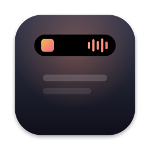

  

<h1 align="center">MeuNotch</h1>

  O notch do seu Mac virando uma <b>Dynamic Island</b>: música, notificações, arquivos, clipboard, foco e IA, 
  sempre a um passar de mouse.

  <a href="https://github.com/pedrohenryk/meunotch/releases/latest/download/MeuNotch.dmg"><b>⬇︎ Baixar o MeuNotch para Mac</b></a> 
  Grátis · macOS 14 ou mais novo · Chip Apple e Intel · Com ou sem notch

---

## O que ele faz

- 🎵 **Música** — capa, controles e o que está tocando (Apple Music, Spotify e YouTube Music), num player no estilo da Dynamic Island, com **letras sincronizadas**.
- 👀 **Notch com vida** — quando nada está acontecendo, uma Carinha que segue o mouse, um gatinho, o clima ao vivo, uma plantinha que cresce com seus focos, um relógio ou uma aurora. Formato grudado no topo ou **flutuante**, como a Dynamic Island do iPhone.
- 🖥️ **Em todas as telas** — um notch em cada monitor, sem cobrir os ícones da barra de menus.
- 💬 **Notificações dos apps** — mensagens do WhatsApp, e-mails e outros avisos saindo do notch.
- 📅 **Agenda** — a próxima reunião com contagem regressiva e botão para entrar na chamada.
- ✦ **IA** — pergunte falando ou digitando; clima e cotações respondidos na hora; corrija ou traduza qualquer texto selecionado (⌥⌘E). Funciona com a Apple Intelligence (grátis, no Mac), sua assinatura do Claude ou do ChatGPT, ou o Gemini com uma chave grátis do Google.
- 📥 **Bandeja de arquivos e clipboard** — arraste arquivos até o notch e recupere tudo o que você copiou (⌥⌘K).
- ⏱ **Foco** — Pomodoro com Não perturbe, timer, cronômetro e lembretes de água e de pausa para os olhos.
- 🔊 **Volume e brilho** no notch, no lugar do quadrado do macOS.
- 🪞 **Espelho** para conferir o visual antes de uma chamada.

## Como instalar

1. **[Baixe o MeuNotch.dmg](https://github.com/pedrohenryk/meunotch/releases/latest/download/MeuNotch.dmg)** e abra.
2. Arraste o **MeuNotch** para a pasta **Aplicativos**.
3. Abra o MeuNotch pela pasta Aplicativos. Na primeira vez o macOS avisa que não consegue verificar o app
   (ele ainda não tem a assinatura paga da Apple). Para liberar, uma vez só:
   - clique em **OK** (ou **Concluído**) no aviso;
   - abra **Ajustes do Sistema › Privacidade e Segurança**, role até o fim e clique em **Abrir Mesmo Assim**
     ao lado do MeuNotch;
   - confirme com a senha ou o Touch ID.
4. As **boas-vindas** mostram o que o app faz, ajudam a escolher a IA e pedem só as permissões dos recursos que você escolher.

> Abriu direto do disco do instalador? O MeuNotch oferece se mover para Aplicativos sozinho.

Depois disso, o MeuNotch **se atualiza sozinho**: quando sai uma versão nova, ele avisa e instala com um clique.

## Privacidade

Sem conta, sem anúncios e sem telemetria. O app só usa a internet para a capa das músicas, para clima e cotações
quando você pergunta, e para a IA do serviço que você escolher. Notificações e clipboard ficam só no seu Mac.

## In English

MeuNotch turns your Mac's notch into a **Dynamic Island**: music with synced lyrics, app notifications (WhatsApp, Mail…),
idle animations (a face that follows your pointer, a kitty, live weather…), a floating or attached notch on every display,
your next meeting, an AI you can talk to (Apple Intelligence, Claude, ChatGPT or a free Gemini key), a file Shelf, clipboard
history, Pomodoro and timers, volume and brightness, and a camera mirror. It follows your Mac's language
(English or Portuguese).

**[Download MeuNotch for Mac](https://github.com/pedrohenryk/meunotch/releases/latest/download/MeuNotch.dmg)** —
free, macOS 14 or later, Apple silicon and Intel, with or without a notch. Drag it to Applications and open it. The
first time, macOS says it can't verify the app: go to **System Settings › Privacy & Security** and click
**Open Anyway** (only once). After that, MeuNotch updates itself.

## Versões

Todas as versões e o que mudou em cada uma estão em [Releases](https://github.com/pedrohenryk/meunotch/releases).
